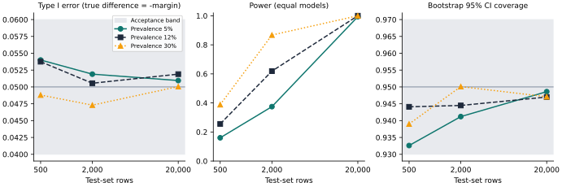

<!--
SPDX-FileCopyrightText: 2026 Ahmed Hemedan
SPDX-License-Identifier: Apache-2.0
-->

# Validation results

The statistics are checked by simulation, nightly and before each release.



**Design.** Prevalence 5, 12 and 30 percent; test sets of 500, 2,000 and 20,000 rows. Both models have binormal scores, correlated 0.8 within each row. The reference AUROC is 0.80 and the margin is 0.02.

- **Type I error.** The new model is worse by exactly the margin. The one-sided non-inferiority test at alpha 0.05 must reject between 4 and 6 percent of the time. There are 20,000 replicates per cell.
- **Power.** The two models are equally good. Power rises with events, as expected.
- **Coverage.** The paired stratified bootstrap 95 percent interval of the net benefit difference at threshold 0.2, with 2,000 bootstrap replicates, must contain the true value between 93 and 97 percent of the time. There are 10,000 replicates per cell.

**Reading the corner.** With 25 positives (5 percent of 500 rows), the normal reference gave a type I error of 0.060. MedAgentRx therefore uses a Student t reference with `min(positives, negatives) - 1` degrees of freedom, which gives 0.054. In the same corner, the percentile interval covers about 93 percent, inside its band but near the edge. Plans with so few events also get a power warning (PERF-006).

**Cross-check.** DeLong AUC, standard errors and z statistics agree with R pROC to 1e-8 on AUC and 1e-6 on standard error and z.

The raw numbers are in [`validation.json`](assets/validation.json). Reproduce them with:

```bash
uv run python scripts/validation.py --out docs/assets
```
